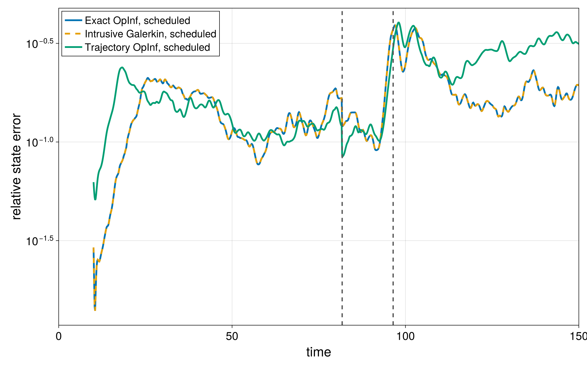

This combined Bachelor End Project explored how high-dimensional flow data can be transformed into smaller predictive models that are faster to analyse while retaining the important dynamics of the original system.

I developed a configuration-driven Julia framework for building, validating, and comparing data-driven reduced-order models of two-dimensional turbulent flows. The workflow brings the experimental pipeline together—from data generation and model construction to parameter studies, error analysis, post-processing, and reporting.

## What I worked on

- Built predictive reduced-order models using numerical linear algebra and regression-based methods.
- Automated repeatable experiments through configuration-driven workflows.
- Performed parameter studies, grid-convergence analysis, and statistical error evaluation.
- Compared reduced models with higher-fidelity simulation data.
- Structured outputs and reports to make experiments easier to reproduce and interpret.

## Technologies and methods

Julia · Reduced-order modelling · Numerical linear algebra · Regression · Simulation-data processing · Model validation · Grid convergence · Error analysis

The project received a **9.0/10** grade in both the Applied Mathematics and Applied Physics programmes.

[View the repository on GitHub](https://github.com/franabaajo/DataDrivenFlowROM.jl)

## What the models capture

The project studies two distinct cases: a vortex dipole colliding with a no-slip wall, and Rayleigh–Bénard convection with a reversal of the large-scale circulation. The figures below come directly from the project's reproducible results.

The comparison shows how different reduced spaces and identification approaches retain—or lose—localized vortex structures close to the wall.

Exact Operator Inference and intrusive Galerkin projection produce matching error trajectories when they use the same reduced basis and feature space. The repository documents the numerical results, assumptions, and limitations in detail.
